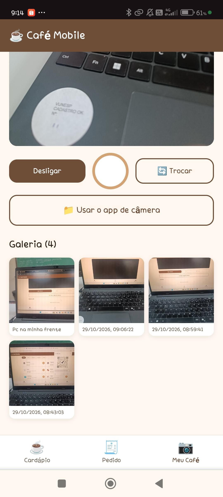

# ☕ Café Mobile — Dia 4: câmera e galeria

App web mobile que usa a câmera do celular (`getUserMedia`), desenha o quadro em um
`canvas` e guarda as fotos no `localStorage`.

- **Arquivos principais:** `index.html`, `css/style.css`, `js/camera.js`
- **Repositório:** https://github.com/hazelbunnii/Coffee-Mobile

---

## 4.2 — Qualidade da foto

### O que mudou

| | Antes | Depois |
|---|---|---|
| Largura da foto | 480 px | **1080 px** |
| Qualidade do JPEG | 0.70 | **0.95** |

```js
// js/camera.js — guardarImagem()
const largura = 1080;
const altura = Math.round((alturaOriginal / larguraOriginal) * largura);
// ...
const imagem = canvas.toDataURL("image/jpeg", 0.95);
```

### O que acontece com a galeria

1. As primeiras fotos ficam bem mais nítidas.
2. A galeria **para de crescer** e começa a **apagar as fotos mais antigas** sozinha.
   Com 480/0.70 as 12 fotos cabiam; com 1080/0.95 cabem por volta de **3 a 6**,
   dependendo do aparelho.
3. O aviso **"Galeria cheia" não aparece**: `guardarImagem()` chama `salvarFotos()`,
   que mostra a mensagem de erro, e logo depois `tirarFoto()` mostra
   "📸 Foto salva na galeria", sobrescrevendo o aviso. O usuário vê "salvo com sucesso"
   enquanto o app apaga fotos.
4. Ao recarregar a página aparecem menos fotos do que foram tiradas.

### Por quê

- 1080 × 810 = **~875 mil pixels** contra 480 × 360 = **~173 mil** → **5× mais pixels**.
- Qualidade 0.95 gera **2–3× mais bytes por pixel** que 0.70.
- Juntando os dois: cada foto fica **~12–15× maior** (de ~30 KB para ~400 KB).
- `canvas.toDataURL()` devolve **base64**, que é ~37% maior que o binário original.
- O `localStorage` guarda apenas **texto** e tem cota de **~5 MB** (no Chrome a cota é
  contada em UTF-16, ~2 bytes por caractere, então cabem ~2,5 milhões de caracteres).
- Resultado: cada foto nova consome perto de **1 MB** da cota → cabem poucas fotos.

Também há um custo de desempenho: `toDataURL()` é **síncrona** e trava a thread
principal, então a captura em 1080/0.95 dá uma pequena engasgada na tela.

### Print



> Galeria com 4 fotos tiradas em 1080 px / 0.95. O título já mostra o contador do
> item 4.4 e uma das fotos tem legenda.

---

## 4.3 — Legenda da foto

Antes de salvar, o app pede uma legenda com `prompt()` e guarda junto da imagem.
A galeria mostra a legenda no lugar da data.

```js
// js/camera.js — guardarImagem()
const resposta = prompt("Legenda da foto:");
if (resposta === null) {
  return false; // usuário cancelou: não salva nada
}
const legenda = resposta.trim() || "Sem legenda";
// ...
fotos.unshift({ imagem: imagem, legenda: legenda, data: new Date().toLocaleString("pt-BR") });
```

```js
// js/camera.js — mostrarGaleria()
legenda.textContent = foto.legenda || foto.data; // fotos antigas mostram a data
```

### Comportamento

| Situação | Resultado |
|---|---|
| Digita `"  Cappuccino  "` | salva `"Cappuccino"` (remove espaços das pontas) |
| Deixa vazio ou só espaços | salva `"Sem legenda"` |
| Clica em **Cancelar** | a foto **não** é salva e o contador não muda |
| Fotos antigas (sem o campo `legenda`) | continuam exibindo a data |

### Print


> A foto mais nova mostra a legenda digitada no `prompt`. As fotos tiradas antes da
> alteração continuam exibindo a data (fallback `foto.legenda || foto.data`).
>
> O print da caixa `prompt("Legenda da foto:")` aberta não foi capturado.

---

## 4.4 — Contador de fotos

O título da galeria mostra quantas fotos existem: **"Galeria (5)"**.

```html
<!-- index.html -->
<h3 id="titulo-galeria">Galeria (0)</h3>
```

```js
// js/camera.js — mostrarGaleria()
tituloGaleria.textContent = "Galeria (" + fotos.length + ")";
```

O contador é atualizado sempre que `mostrarGaleria()` roda: ao abrir o app, ao tirar
uma foto e ao cancelar a legenda (nesse caso o número não muda).

### Print

| Antes (versão anterior) | Depois (com contador) |
|---|---|
|  |  |

> No print da esquerda o título é só **"Galeria"** (e a câmera está sem permissão).
> No da direita aparece **"Galeria (4)"** com as 4 fotos salvas.

---

## Como testar

1. Abra o app pelo link **https** (a câmera exige HTTPS ou localhost).
2. Toque em **📷 Meu Café** → **Ligar câmera** e permita o acesso.
3. Tire uma foto, digite a legenda e confirme.
4. Veja o título **Galeria (1)** e a legenda abaixo da miniatura.
5. Repita até encher a galeria para observar o limite de armazenamento (item 4.2).

## Observações

- Limite de **12 fotos** por galeria (`if (fotos.length > 12) fotos.pop()`).
- Se a cota do `localStorage` estourar, a foto **mais antiga** é removida e a gravação
  é tentada de novo.

## Publicar no GitHub Pages (necessário para testar a câmera no celular)

A câmera exige **HTTPS** (ou `localhost`), então abrir o `index.html` direto no celular
não funciona. Para publicar:

1. No repositório: **Settings → Pages**.
2. Em *Source*, escolha **Deploy from a branch**.
3. Branch: **main** — pasta: **/ (root)** → **Save**.
4. Em ~1 minuto o app fica em `https://hazelbunnii.github.io/Coffee-Mobile/`.

