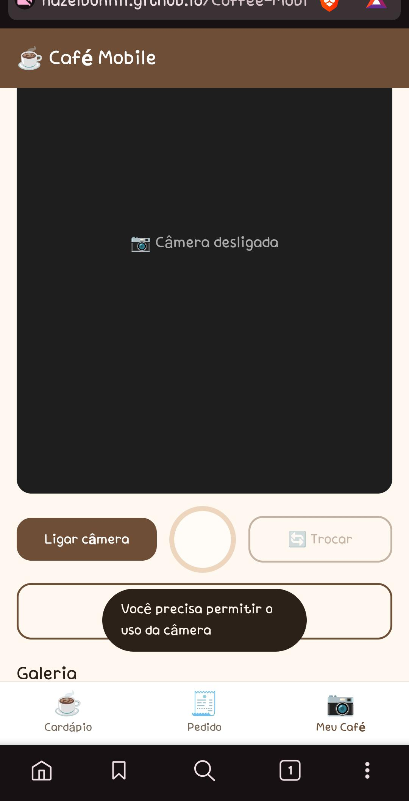

# Dia 4 — Câmera

## 4.1 — Permissão negada

**Mensagem que o app mostra:** `Você precisa permitir o uso da câmera`

O aviso aparece por 2 segundos no rodapé da tela, a câmera não liga e o botão de foto
continua desabilitado. O app identifica o erro pelo nome `NotAllowedError`:

```js
// js/camera.js — ligarCamera()
} catch (erro) {
  if (erro.name === "NotAllowedError") {
    mostrarAviso("Você precisa permitir o uso da câmera");
  } else {
    mostrarAviso("Não foi possível abrir a câmera (" + erro.name + ")");
  }
}
```

**Como liberar de novo pelo cadeado:**

1. Toque no **cadeado** (ou no ícone de ajustes) ao lado do endereço do site.
2. Abra **Permissões** → **Câmera**.
3. Marque **Permitir**.
4. Recarregue a página e toque em **Ligar câmera**.

> No iPhone o cadeado não existe: toque no **"aA"** da barra de endereço →
> **Ajustes do Site** → **Câmera** → **Permitir**. Se não aparecer, use
> **Ajustes → Safari → Câmera**. Em último caso, limpe os dados do site e recarregue.



---

## 4.2 — Qualidade da foto

**O que acontece com a galeria:** ela passa a **apagar as fotos mais antigas** antes de
chegar ao limite de 12. Cada foto fica cerca de **12 a 15 vezes maior**, e como o
`localStorage` tem apenas ~5 MB, só cabem de **3 a 6 fotos** em vez de 12.

Pior: o aviso **"Galeria cheia: a foto mais antiga foi removida"** é sobrescrito
imediatamente por **"📸 Foto salva na galeria"**, então o usuário não percebe que perdeu
fotos.

**Código alterado:**

```js
// js/camera.js — guardarImagem()
// antes
const largura = 480;
const imagem = canvas.toDataURL("image/jpeg", 0.7);

// depois
const largura = 1080;
const imagem = canvas.toDataURL("image/jpeg", 0.95);
```

**Por quê:**

- 1080 × 810 = **~875 mil pixels**; 480 × 360 = **~173 mil** → **5× mais pixels**.
- Qualidade 0.95 gera **2–3× mais bytes por pixel** que 0.70.
- Juntando os dois, cada foto sai de ~30 KB para ~400 KB.
- `toDataURL()` devolve **base64**, que é ~37% maior que o binário.
- O `localStorage` só guarda **texto** e tem cota de **~5 MB** (no Chrome contada em
  UTF-16, ~2 bytes por caractere) → cada foto consome perto de **1 MB** da cota.

---

## 4.3 — Legenda

A legenda é pedida com `prompt("Legenda da foto:")` antes de salvar e é exibida no
lugar da data. Se o usuário cancelar, a foto não é salva; se deixar vazio, grava
`"Sem legenda"`.

**Código alterado:**

```js
// js/camera.js — guardarImagem()
// antes
fotos.unshift({ imagem: imagem, data: new Date().toLocaleString("pt-BR") });

// depois
const resposta = prompt("Legenda da foto:");
if (resposta === null) {
  return false; // usuário cancelou: não salva nada
}
const legenda = resposta.trim() || "Sem legenda";

fotos.unshift({
  imagem: imagem,
  legenda: legenda,
  data: new Date().toLocaleString("pt-BR")
});
```

```js
// js/camera.js — mostrarGaleria()
// antes:  <small>${foto.data}</small>
// depois
legenda.textContent = foto.legenda || foto.data;
```


---

## 4.4 — Contador de fotos

O contador aparece ao lado do título e é atualizado sempre que a galeria é redesenhada.

**Código alterado:**

```html
<!-- index.html -->
<!-- antes -->
<h3>Galeria</h3>

<!-- depois -->
<h3 id="titulo-galeria">Galeria (0)</h3>
```

```js
// js/camera.js — mostrarGaleria()
tituloGaleria.textContent = "Galeria (" + fotos.length + ")";
```


