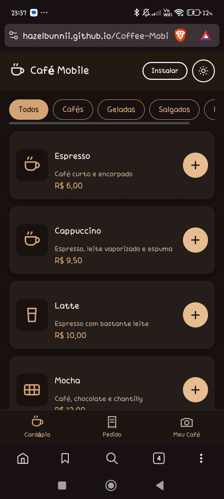
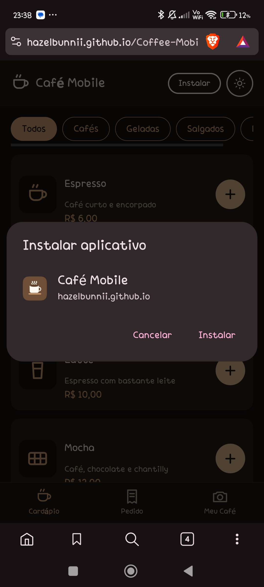
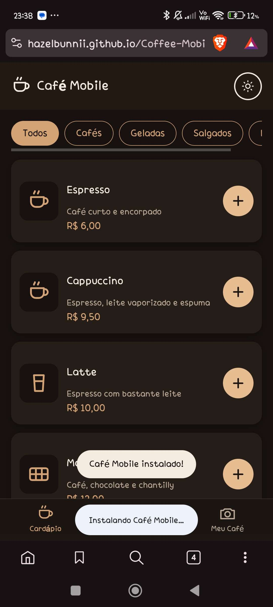
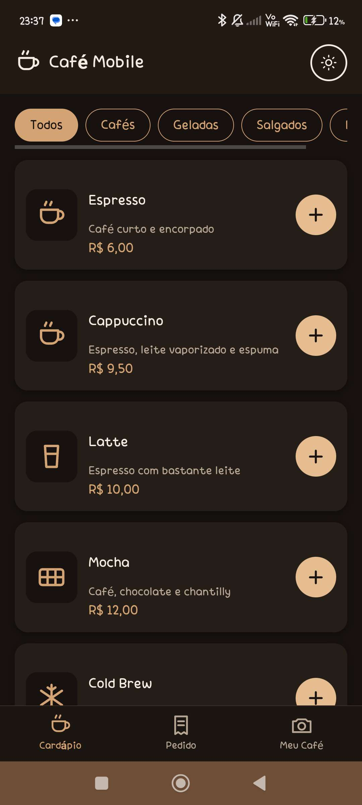
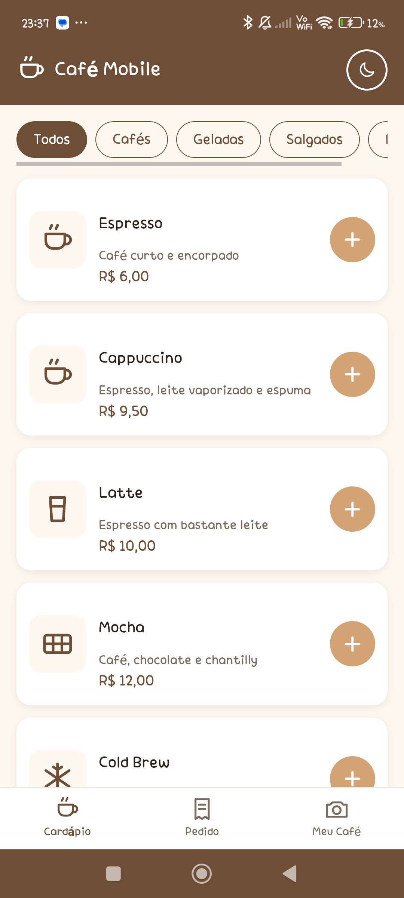

# Café Mobile

Aplicativo de cafeteria feito com **HTML, CSS e JavaScript puro**, empacotado como **PWA**: pode ser instalado na tela de início do celular e abre mesmo sem internet.

## Funcionalidades

- **Cardápio**: produtos com filtros por categoria (Todos, Cafés, Geladas, Salgados e Doces).
- **Pedido**: adicione itens, mude quantidades, veja o total e compartilhe o resumo. O pedido fica salvo no `localStorage`.
- **Meu Café**: câmera frontal e traseira, galeria com até 12 fotos e opção de usar o app de câmera do próprio celular.
- **Compartilhamento**: usa a Web Share API para pedidos e fotos; quando o aparelho não suporta, copia o texto para a área de transferência.
- **PWA**: `manifest.json` define nome, ícones e cores; `sw.js` guarda os arquivos no aparelho (estratégia "rede primeiro", com cópia offline).
- **Modo escuro**: o app já abre escuro e o botão no topo permite alternar para o claro.
- **Ícones SVG**: emojis foram substituídos por ícones vetoriais — aparecem iguais em qualquer celular e funcionam offline.

## Modo escuro

O app **sempre abre no modo escuro**. O botão de lua/sol no topo permite alternar para o claro; essa escolha fica salva no `localStorage` (chave `tema-v2`) e vale nas próximas aberturas.

Por baixo dos panos:

- Um script minúsculo no `<head>` do `index.html` aplica `data-tema="escuro"` antes mesmo do CSS carregar, então não dá tempo de "piscar" a versão clara ao abrir.
- `js/tema.js` confirma o tema na carga, troca o ícone do botão (sol/lua) e atualiza a meta tag `theme-color` (a cor da barra do navegador/app instalado).
- `css/style.css` troca um conjunto de variáveis CSS (`--cor-fundo`, `--cor-card`, `--cor-texto`, etc.), então todos os componentes acompanham o tema sem duplicar regras.
- O escuro é o padrão das variáveis em `:root`, então o app já nasce escuro mesmo se o JavaScript falhar. O claro só aparece quando `data-tema="claro"` é aplicado.

## Ícones

Todos os ícones ficam centralizados em `js/icones.js`, como SVGs que usam `currentColor` (herdam a cor do tema).

- No HTML, use `<span data-icone="cafe"></span>`, por exemplo.
- No JavaScript, use `icone("compartilhar")` dentro do `innerHTML`.
- Para adicionar um ícone novo, crie uma entrada em `ICONES` com os caminhos do SVG e use o nome escolhido.

## Como executar

Sirva a pasta por HTTP. Por exemplo, dentro do projeto:

```bash
python -m http.server 8080
```

Depois abra `http://localhost:8080` no navegador.

> Câmera, instalação e Service Worker exigem **HTTPS** ou `localhost`. Abrir o `index.html` direto (`file://`) não funciona para esses recursos.

Para testar no celular, publique em HTTPS (o GitHub Pages serve). Com o repo neste endereço, a URL será `https://hazelbunnii.github.io/Coffee-Mobile/` após ativar **Settings → Pages → Deploy from branch → main**.

## Prints

Site:







App instalado no celular:





## Estrutura

```
index.html          telas, filtros, barra de abas e botão de tema
css/style.css       variáveis de tema, layout claro/escuro e ícones
js/dados.js         cardápio (nome, descrição, preço, categoria e ícone)
js/icones.js        biblioteca de SVGs usada no lugar dos emojis
js/tema.js          modo escuro automático + alternância manual
js/app.js           navegação, cardápio, pedido e localStorage
js/camera.js        câmera, fotos e galeria
js/pwa.js           Service Worker, botão Instalar e Web Share
manifest.json       dados do app para instalação
sw.js               cache offline (incrementar CACHE ao mudar arquivos)
icons/              ícones do app nas versões 192, 512 e maskable
docs/img/           prints do site e do app instalado
```
